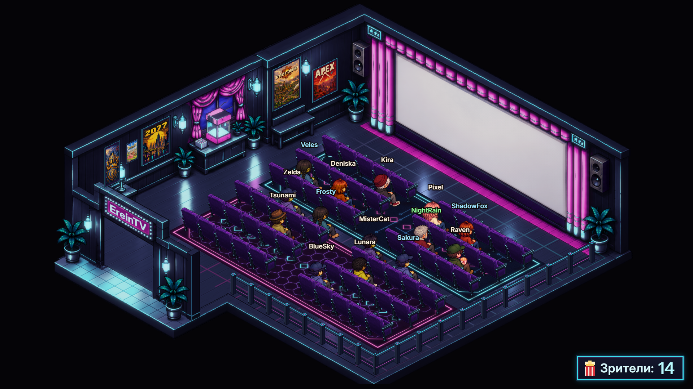

# Viewer Cinema

Оверлей для OBS: зрители Twitch занимают места в изометрическом кинотеатре.
Список зрителей и сообщения чата поступают из Streamer.bot. В зале 60 мест;
при переполнении новые зрители ждут освобождения кресла.
В комплекте 12 образов персонажей с вариантами одежды; внешность зависит от логина.

Работает из локальной папки, без сборки. Графика и шрифт Inter включены в комплект.




## Быстрый запуск

1. Скачайте проект целиком и распакуйте в отдельную папку.
2. Подключите Twitch в Streamer.bot. Включите **Servers/Clients → WebSocket Server**
   и **Auto Start**. По умолчанию используются `127.0.0.1:8080` и endpoint `/`.
3. В **Platforms → Twitch → Settings → Present Viewers** включите обновление
   присутствующих зрителей. Это источник списка персонажей оверлея.
4. В OBS добавьте **Browser Source → Local file**, выберите нужный HTML-файл
   и задайте размер **1920×1080**.
5. Настройте `config.js` и обновите Browser Source после сохранения.

Если WebSocket Server требует аутентификацию, укажите его пароль в `password`.
Для проверки без Streamer.bot откройте страницу с `?demo=1`.

## Страницы для сцен OBS

| Страница | Содержимое экрана кинотеатра |
|---|---|
| `index.html` | Пустой экран для основной сцены |
| `starting.html` | Приветствие «Стрим скоро начнется» |
| `break.html` | Чат во время перерыва |
| `ending.html` | Завершение → титры → благодарность |

Все страницы используют общие настройки и графику. Текст на экране автоматически
подгоняется под его границы. Независимые Browser Source имеют отдельные анимации;
для одного общего зала в нескольких сценах используйте **Add Existing**.

По умолчанию места и движение сохраняются между перезагрузками. Для обычных сцен
рекомендуется выключить **Shutdown source when not visible** и
**Refresh browser when scene becomes active**. Для `ending.html` обновление при
активации полезно, если титры должны каждый раз начинаться заново со свежими данными.

## Настройки

Основные параметры находятся в `config.js`. URL-параметры переопределяют их
для отдельного источника, например: `starting.html?text=Скоро%20начнем!&bg=transparent`.

| В `config.js` | В URL | Назначение |
|---|---|---|
| `host`, `port`, `endpoint`, `password` | те же имена | Подключение к Streamer.bot |
| `secure` | `secure=1` | Защищённый WebSocket (`wss`) |
| `cinemaTheme` | `theme=classic` / `cyberpunk` | Оформление зала |
| `background` | `bg=dark` / `transparent` / цвет | Фон вокруг зала |
| `signText` | `sign=` | Надпись на вывеске |
| `maxSeats` | `seats=` | Лимит мест, до 60 |
| `showCounter`, `counterLabel` | `counter=0` | Видимость и подпись счётчика |
| `ignore`, `hideBroadcaster` | `ignore=bot1,bot2`, `hideBroadcaster=1` | Исключение аккаунтов |
| `pollSeconds` | `poll=` | Период сверки зрителей; `0` — только события |
| `leaveGraceSeconds` | `grace=` | Задержка перед уходом пропавшего из списка зрителя |
| `initialEntrance` | `initial=seated` / `walk` | Рассадить присутствующих сразу или показать их вход |
| `rememberAudience` | `remember=0` | Сохранение состояния зала |
| `startingText`, `endingText` | `text=` | Текст соответствующей сцены |
| `breakText` | — | Заголовок встроенного чата |
| `thanksText` | `thanks=` | Финальная благодарность |
| `creditsSpeed` | `creditsSpeed=` | Скорость титров |
| `creditsIntroSeconds`, `creditsThanksSeconds` | `creditsIntro=`, `creditsThanks=` | Длительность вступления и благодарности |
| `creditsLoop` | `creditsLoop=1` / `0` | Повторять весь цикл титров или показать один раз |
| `showChatBubbles` | `bubbles=0` | Сообщения над персонажами |
| `chatBubbleSeconds`, `chatBubbleMaxChars` | `bubbleSeconds=`, `bubbleChars=` | Время показа и длина сообщения |
| `demo`, `debug` | `demo=1`, `debug=1` | Демо-аудитория и сообщения в консоли |

### Темы оформления

`cinemaTheme` в `config.js` выбирает оформление зала:

- `classic` — деревянный зал с бархатными креслами (по умолчанию);
- `cyberpunk` — неоновый зал: металлический пол с подсветкой, неоновые ковры и кресла.

Тема меняет фон зала, кресла, ковры, ограждение, рамки постеров, вывеску, счётчик
и облачка; планировка, места и маршруты зрителей одинаковы. Параметр `?theme=`
работает на всех страницах, например `index.html?theme=cyberpunk&demo=1`.
Неизвестное название включает `classic`.

### Постеры и ковры

По умолчанию установлены постеры пяти игр. Их можно заменить своими изображениями
из `assets/posters/`, изменив пути в `config.js`:

```js
posters: {
  poster1: 'assets/posters/world-of-warcraft.png',
  poster2: 'assets/posters/ragnarok-online.png',
  poster3: 'assets/posters/cyberpunk-2077.png',
  poster4: 'assets/posters/factorio.png',
  poster5: 'assets/posters/apex-legends.png'
},
```

Места `poster1`–`poster5` идут слева направо по левой стене. `null` оставляет место
пустым; рамка добавляется автоматически. При ошибке загрузки постер не показывается.

Ковры задаются в `rugs.rug1` и `rugs.rug2`. Используйте обычные прямоугольные
изображения без перспективы. `null` скрывает ковёр, неверный путь возвращает
комплектную текстуру. Комплектные ковры любой темы заменяются коврами выбранной темы,
свои изображения показываются во всех темах.

## Чат и облачка

По умолчанию `break.html` получает новые сообщения Twitch через WebSocket
Streamer.bot: `chatMode: 'streamerbot'`, `chatUrl: ''`. История сообщений,
графические эмоуты и бейджи в этом режиме не отображаются.

Чтобы использовать внешний виджет, вставьте **полную ссылку для встраивания**
в `chatUrl`. Например, ссылку Streamer.bot Chat вместе с её `?config=…`.
Дополнительное кодирование в `config.js` не нужно. Для URL-параметра `chatUrl=`
вложенную ссылку нужно кодировать через `encodeURIComponent`.

Виджет должен разрешать iframe. Его настройки подключения и шрифт задаются
у провайдера: `host`/`port` оверлея их не переписывают. При очищении истории
виджетом проверяйте чат новым сообщением после загрузки страницы.

Облачка работают через собственное соединение оверлея с Streamer.bot,
независимо от внешнего виджета. Они привязываются к персонажам по логину.
Длинный текст обрезается с троеточием, новое сообщение заменяет предыдущее.
Одновременно хранится не больше четырёх облачков; соседние могут временно скрываться
при пересечении. Если персонажа ещё нет, оверлей кратко ждёт обновления списка
зрителей. Само сообщение не создаёт персонажа. В режиме `demo` реальный чат не подключается.

## Титры Streamer.bot

В **Services → Credits** включите нужные события и **Users Present (spoke) → Users**.
Для записей текущего стрима настройте **Reset Credits** на **Stream Online**,
а не перед финальной сценой. Ранее произошедшие события после включения записи
не восстанавливаются. Список Users включает учтённых участников чата, а не всех
молча смотревших трансляцию.

Состав и порядок групп задаются в `creditsGroups`:

```js
{ title: 'Наши зрители', path: ['users', 'users'] },
{ title: 'Новые фолловеры', path: ['events', 'follows'] }
```

Пустые группы и незаполненные `%аргументы%` пропускаются. Регистр ключей не важен.
Оверлей читает данные через `GetCredits`, не вызывает `TestCredits` и ничего не сбрасывает.

`creditsLoop: true` повторяет весь цикл: завершение → титры → благодарность.
При `false` благодарность остаётся на экране. Повторы используют снимок, полученный
при загрузке: обновите источник OBS, чтобы запросить свежие Credits.

**«Топ баллов канала»** — готовый `top.channelRewards` от Streamer.bot, а не
рассчитанные оверлеем расходы за стрим. Для него нужен **Track Top → Channel Points Used**.
Сброс Credits не гарантирует сброс статистики этого рейтинга.

## Если что-то не работает

- Проверьте адрес, порт и пароль WebSocket Server, затем обновите источник OBS.
- При отсутствии персонажей проверьте Present Viewers, список `ignore` и подключение Twitch.
- При отсутствии имён в титрах проверьте включённые категории Credits и обновите `ending.html`.
- Для облачков проверьте `showChatBubbles`, наличие персонажа автора и выключенный `demo`.
  Работа внешнего виджета сама по себе не подтверждает получение событий оверлеем.
- При ошибке загрузки графики проверьте, что скачан весь проект с папками `assets` и `fonts`.

В консоли страницы доступен `__cinema.chatDiagnostics()`: `subscribed` показывает
успех подписки, `received` — число событий, `invalid` — неизвестный формат,
`waiting` — сообщения до появления персонажа, `shown` и `visible` — облачка.
Диагностика не содержит сообщений и паролей. `debug=1` включает дополнительные логи.

## Разработка

Сборка и зависимости для запуска оверлея не нужны. Для тестов требуются Node.js,
Python 3 и Playwright с Chromium. Установка и команды — в [tests/README.md](tests/README.md).
Карта графических ресурсов — в [assets/README.md](assets/README.md).
Inter включён по лицензии [SIL OFL](fonts/Inter-OFL.txt).
