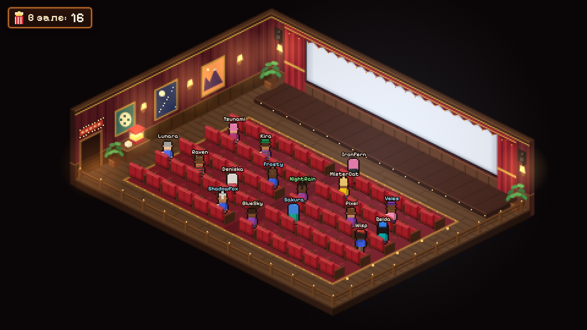

# Viewer Cinema — оверлей Streamer.bot для OBS

Пиксельный изометрический кинотеатр. Каждый зритель, которого Streamer.bot сообщает как присутствующего, получает уникального персонажа, который входит через дверь, находит свободное место, доходит по проходу между рядами до своего кресла, разворачивается к нему спиной (к экрану) и садится, отступая в кресло. Когда зритель уходит, персонаж встаёт, выходя из кресла в проход спиной к нему, и только потом поворачивается по ходу движения и выходит. Счётчик `Зрители: N` в правом нижнем углу показывает, сколько человек внутри.

Зал рассчитан на **60 зрителей: 6 рядов по 10 кресел**, разделённых широким центральным проходом (4 единицы между осями крайних кресел). Идущие держатся левого края прохода: кресло со стороны камеры перекрывает человека, и только на расстоянии около 2,3 единицы закрывает лишь обувь. По той же причине у левой стены прохода нет — к местам левого блока идут по центральному проходу и вдоль ряда. Ковры, ряды и ограждение используют одну плоскость пола, заданную четырьмя углами, снятыми с нарисованных кромок фона (основание стены экрана, передняя кромка пола, правая кромка, основание левой стены). Проективное отображение кладёт ряды точно параллельно стене с экраном и стене со входом. Первый ряд отстоит от стены экрана на 4,1 единицы (около 124 пикселей иллюстрации по перпендикуляру); между коврами остаётся поперечный проход. Ограждение следует границам пола и начинается за стеной входа. Траектории пересекают нарисованный дверной проём; фасад и перемычка корректно перекрывают проходящих зрителей. Пришедший зритель плавно проявляется у двери снаружи, уходящий так же плавно растворяется там после выхода. За дверью персонаж проходит за косяк и низкую стенку фасада напрямую, а поперечный проход за последним рядом проложен там, где стена уже не обрезает ноги. Интерьер, кресла и персонажи используют отдельные детализированные графические ассеты: мелкая фактура бархата и дерева, складки штор, локальный янтарный свет, контактные тени и блики на подлокотниках. Крупная процедурная сетка больше не используется как основной арт. На левой стене предусмотрено пять мест для пользовательских постеров; по умолчанию стена пустая. Вход расположен на переднем левом фасаде, обращён к зрителю. Рамка вывески и лампы остаются частью фасада, а надпись (по умолчанию CINEMA) настраивается отдельно и автоматически помещается внутри таблички. Экран остаётся пустым.



Без этапа сборки и внешних зависимостей. Работает из локальной папки в OBS Browser Source. Шрифт (Pixelify Sans, OFL) включён в комплект.

---

## 1. Настройка Streamer.bot

1. **Servers/Clients → WebSocket Server**
   - Включите **Auto Start** (и запустите сервер один раз).
   - По умолчанию: адрес `127.0.0.1`, порт `8080`, endpoint `/`.
   - **Authentication**: опционально. Если включаете **с "Enforce"**, укажите тот же пароль в оверлее (см. ниже). При включённой аутентификации, но *не* принудительной, оверлей работает без пароля, так как использует только read-only запросы.
2. **Platforms → Twitch → Settings → Present Viewers.** Это определяет, кто считается "присутствующим":
   - *Live Update* выключено (по умолчанию): зрители, активные в чате в пределах порога (по умолчанию 5 мин), считаются присутствующими; список обновляется каждую минуту.
   - *Live Update* включено: реальный список чаттеров Twitch, обновляется каждые 1–10 мин.
   - Убедитесь, что таймер Present Viewers не отключён.
3. Twitch должен быть подключён в Streamer.bot (аккаунт вещателя).

## 2. Настройка OBS

Sources → **+** → **Browser**

- **Local file**: ☑, выберите `index.html` из этой папки
  (или снимите галочку и используйте URL вроде `file:///C:/overlays/viewer-cinema/index.html?bg=transparent`).
- **Width 1920, Height 1080**. Художественные слои компонуются в буфере **1920×1080**, поэтому в Full HD сохраняется мелкая фактура исходных изображений. Сетка 960×540 служит только для координат движения. При 3840×2160 готовый арт увеличивается в 2 раза, при 960×540 уменьшается вдвое. В OBS задайте Browser Source нужный размер и избегайте произвольного растяжения готового источника.
- Для нескольких сцен выбирайте **Add Existing / Добавить существующий** Browser Source: это один и тот же зал. Независимые источники с разными URL или изоляцией браузерного хранилища могут иметь отдельное состояние.
- **"Shutdown source when not visible"** и **"Refresh browser when scene becomes active"** рекомендуется выключить, чтобы не перезапускать страницу и WebSocket без необходимости. Если OBS всё же перезагрузит источник, сохранённые места и движение восстанавливаются без повторного входа всех зрителей.
- При первом запуске уже присутствующие зрители **сразу сидят**; новые зрители входят через дверь. `initial=walk` включает вход при первом запуске без сохранённого состояния.

## 3. Конфигурация

Отредактируйте `config.js` один раз, **или** добавьте URL-параметры для каждого источника (URL-параметры имеют приоритет):

| Параметр | По умолчанию | Значение |
|---|---|---|
| `host` / `port` / `endpoint` | `127.0.0.1` / `8080` / `/` | Адрес WebSocket Server Streamer.bot |
| `secure=1` | выкл | использовать `wss://` (удалённые конфигурации за TLS) |
| `password=` | пусто | Пароль WebSocket (нужен только при включённом *Enforce*) |
| `bg=` | `dark` | `dark`, `transparent` или цвет, например `%23101010` |
| `grace=` | `90` | секунд, в течение которых зритель может отсутствовать в списке до выхода (списки мерцают) |
| `poll=` | `60` | безопасная ресинхронизация каждые N секунд; `0` = полагаться только на события |
| `seats=` | `60` | лимит мест (в зале 60 мест) |
| `initial=` | `seated` | Режим первого запуска без сохранения: `seated` — сразу сидят, `walk` — входят. Сохранённый зал восстанавливается в обоих режимах |
| `remember=0` | сохранение вкл | отключить чтение и запись состояния зала в браузерное хранилище |
| `hideBroadcaster=1` | выкл | не сажать вещателя |
| `ignore=a,b,c` | общие боты | аккаунты, которые никогда не сажаются (заменяет список в `config.js`) |
| `counter=0` | вкл | скрыть счётчик |
| `sign=` | `CINEMA` | текст вывески; автоматически уменьшается под размер таблички, пустое значение скрывает надпись |
| `demo=1` | выкл | симулированная аудитория, Streamer.bot не нужен (превью / тестирование) |
| `debug=1` | выкл | логировать только в консоль браузера; ничего лишнего не рисуется |

Пример: `index.html?port=8080&password=hunter2&bg=transparent&grace=120`

Цвета имён: модераторы зелёные, VIP розовые, подписчики голубые, вещатель золотой, все остальные кремовые.

### Вывеска и постеры

В `config.js` задайте `signText: 'Название канала'`. Поддерживаются русский и латинский текст, цифры и знаки, доступные в шрифте. Можно переопределить название URL-параметром `?sign=MyChannel`. Текст центрируется, сохраняет пропорции букв и наклон фасада. Длинное название уменьшается целиком, без обрезки; очень длинные названия на небольшой табличке будут мелкими.

Встроенных постеров нет. Добавьте свои изображения в `assets/posters` и укажите пути в объекте `posters` в `config.js`:

```js
posters: {
  poster1: 'assets/posters/my-poster-1.png',
  poster2: 'assets/posters/my-poster-2.png',
  poster3: 'assets/posters/my-poster-3.png',
  poster4: 'assets/posters/my-poster-4.png',
  poster5: 'assets/posters/my-poster-5.png'
},
```

Пять мест сохранены в прежних позициях и пронумерованы **слева направо: `poster1` … `poster5`**. Укажите путь к своему PNG/JPG/SVG для нужного места. Настройка `null`, отсутствующий путь или ошибка загрузки оставляют пустую стену без рамки. Рамка создаётся только для успешно загруженного изображения и следует перспективе стены. Изображение обрезается по центру без растяжения. Используйте локальные файлы для автономной работы в OBS. После изменения перезагрузите источник. Пример выше показывает пользовательские имена файлов; они не входят в комплект.

### Ковры

В комнате один фон — `assets/art/cinema-room-aligned.png`. Ковры лежат отдельными слоями поверх пола и заменяются независимо:

```js
rugs: {
  rug1: 'assets/art/rug-1.png', // ближе к экрану
  rug2: 'assets/art/rug-2.png'  // ближе ко входу
},
```

Укажите пути к своим PNG/JPG/SVG в `config.js` или замените сами файлы. Используйте обычное прямоугольное изображение ковра **видом сверху**, без перспективы: оверлей сам уложит его в плоскость пола. Комплектные текстуры имеют размер 1024×384; другой размер тоже поддерживается. `rug1: null` скрывает первый ковёр, `rug2: null` — второй. Отсутствующая настройка или ошибка загрузки возвращает комплектную текстуру. Для OBS храните изображения локально. После изменения перезагрузите источник.

## 4. Как это общается со Streamer.bot

Протокол был проверен по официальному исходнику `@streamerbot/client` и docs.streamer.bot. Затем он был протестирован против протокольно-точного mock-сервера (`tests/`); против живого экземпляра Streamer.bot он ещё не запускался.

1. Подключение к `ws://host:port/endpoint` → сервер отправляет `{"request":"Hello", "info":{…}, "authentication":{salt, challenge}?}`.
2. Если присутствует challenge и задан пароль:
   `authentication = base64(sha256( base64(sha256(password + salt)) + challenge ))` →
   `{"request":"Authenticate","id":…,"authentication":…}`.
3. `{"request":"Subscribe","id":…,"events":{"Twitch":["PresentViewers"]}}`
4. `{"request":"GetActiveViewers","id":…}` → `{"status":"ok","count":N,"viewers":[{"login","display","role","subscribed",…}]}`

Список повторно запрашивается при подключении, всякий раз когда Streamer.bot срабатывает **Twitch.PresentViewers**, и медленным страховочным опросом (по умолчанию 60 с, пропускается, если только что было обновление по событию). Это максимум один небольшой локальный запрос в минуту.

**Поведение при сбоях**
- Переподключение с экспоненциальной задержкой (1 с → 30 с максимум, с джиттером). Никогда не крутится в плотном цикле.
- Неверный пароль — 60 с между попытками. Консоль сообщает причину.
- Если два запроса подряд остались без ответа, сокет считается полуоткрытым и пересоздаётся.
- Некорректный JSON, неизвестные фреймы и невалидные ответы игнорируются. Плохой ответ никогда не опустошает зал.
- Пока соединение потеряно, аудитория остаётся на экране. Синхронизация происходит при возвращении соединения.

## 5. Детали поведения

- **Переключение сцен и перезагрузка источника.** Места, очередь, положение на маршруте и сидячая поза сохраняются локально раз в секунду и при скрытии/закрытии страницы. Состояние хранится до 12 часов для того же подключения, режима demo, лимита мест и фильтров. Пароль Streamer.bot не сохраняется. После восстановления список сверяется с сервером; новые зрители входят обычным образом. Если браузер запрещает хранилище, оверлей продолжает работать, а присутствующие при запуске сразу сидят (`initial=seated`). Для полностью нового зала используйте `remember=0`; для нового входа всей аудитории — `remember=0&initial=walk`.
- **Стабильная идентичность.** Иллюстрированный персонаж, причёска/головной убор и вариант палитры выбираются по логину, поэтому один и тот же зритель всегда выглядит одинаково. Используются два атласа с позами стоя, в движении и сидя; ходьба лицом к зрителю анимируется из позы стоя (ноги шагают попеременно от бедра), ходьба спиной — из нарисованного шага; среди образов есть кепки, федора, разные волосы и одежда. Места запоминаются, поэтому вернувшийся зритель садится на своё место, если оно свободно.
- **Выбор места.** Предпочтительны средние ряды и места ближе к центру. Зал заполняется с разбросом, что сохраняет читаемость имён.
- **Без дубликатов и двойных броней.** Один персонаж на логин и один occupant на место. Место остаётся зарезервированным, пока его персонаж фактически не вышел через дверь.
- **Одновременные прибытия** стоят в очереди у двери и входят по одному, быстрее при скоплении. Идущие держат дистанцию; навстречу друг другу расходятся, принимая вправо, а в остальное время идут по оси прохода.
- **Уход посреди ходьбы / возвращение посреди выхода.** Персонаж разворачивается на месте; телепортации нет.
- **Полный зал.** Лишние зрители ждут снаружи, невидимые и не считаемые. Они входят, как только освобождается место.
- **Длинные стримы.** Один цикл `requestAnimationFrame`, независимый от частоты кадров, с ограниченным `dt`. Спрайты кэшируются на персонажа и освобождаются при выходе. Память мест ограничена 500 логинами. Обычное скрытие источника сохраняет зал и подключение. При выгрузке страницы таймеры и сокет освобождаются; при возврате из браузерного кэша подключение возобновляется.

## 6. Файлы

```
index.html               точка входа (классические скрипты → работает из file:// в OBS)
config.js                значения по умолчанию для развёртывания
css/overlay.css          вёрстка + счётчик
fonts/                   Pixelify Sans (SIL OFL)
assets/art/              локальные PNG: интерьер, кресло и атлас поз персонажей
js/art.js                загрузка ассетов, подготовка слоёв и кадров персонажей
js/decor.js              отдельные объекты постеров, их замены и текст вывески с подгонкой
js/util.js               хеширование, PRNG, SHA-256 (WebCrypto + чистый JS запасной вариант)
js/streamerbot-client.js WebSocket, Hello/auth, запросы, события, переподключение
js/viewer-sync.js        политика опроса GetActiveViewers + валидация payload
js/layout.js             геометрия мира, места, маршруты ходьбы, проекция
js/room-mesh.js          контрольные линии старого исправления перспективы (для авторских скриптов и тестов)
js/room-warp.js          аффинная отрисовка треугольников (перенос текстуры ковров на пол)
js/seats.js              распределение мест
js/audience.js           состояние зрителей: diffing, grace, очередь у двери, линия ожидания
js/session.js            локальное сохранение и восстановление зала после перезагрузки OBS
js/actors.js             движение персонажей / машина состояний сидения
js/characters.js         процедурные пиксель-арт персонажи
js/scene.js              статичный арт кинотеатра + источники света
js/renderer.js           композиция кадра, сортировка по глубине, подписи имён, счётчик
js/demo.js               симуляция ?demo=1
tests/                   mock-сервер Streamer.bot + сквозные сценарии
```

## 7. Тестирование

```
node tests/mock-streamerbot.js --port 8080 [--password secret --enforce]
# откройте index.html?port=8080 и управляйте:
curl "http://127.0.0.1:8080/set?viewers=alice,bob,carol"
curl "http://127.0.0.1:8080/event"        # сработать Twitch.PresentViewers
curl "http://127.0.0.1:8080/drop"         # убить соединения
curl "http://127.0.0.1:8080/malformed"    # мусорные фреймы + плохой ответ

python3 tests/run_tests.py                # полный автотестовый набор (нужны Playwright + Chromium)
python3 tests/room_mesh.py                # геометрия исправления фона (стандартная библиотека Python)
```

Набор покрывает следующее:
- Пустой и предзаполненный старт.
- Одиночные и 12-одновременных присоединений.
- Уход с grace, и уход-затем-возврат (посреди выхода и после выхода).
- Обрыв соединения и перезапуск сервера с backoff.
- Некорректные данные.
- Переполнение вместимости с линией ожидания.
- Аутентификация: правильный и неверный пароль, Enforce вкл и выкл.
- Полуоткрытый сокет.
- Перезагрузка источника без повторного входа; сохранение места и прогресса ходьбы.
- Возобновление WebSocket после восстановления страницы, повреждённое/запрещённое хранилище.
- Счётчик «Зрители» справа внизу, масштабирование и загрузка графических ассетов с рендером 1920×1080.
- Независимые постеры, замена и скрытие отдельных изображений, чистая стена под ними; короткая, длинная, русская и пустая надпись вывески.
- Проверка углов по реальным пикселям экрана и балок входа; отдельные полосы старого рисунка служат отрицательным примером.
- Независимая замена ковров прямоугольными текстурами, скрытие и возврат к стандартной текстуре при ошибке загрузки.
- 75-секундный прогон churn с ~140 посетителями, проверка heap, очередей и частоты кадров.

### Быстрая проверка с реальным Streamer.bot
Откройте `index.html?debug=1` в Chrome, нажмите F12 → Console. Вы должны увидеть `state → ready` и `viewers (connected): N`. Сравните N со списком зрителей во вкладке Viewers Streamer.bot. После следующего тика Present Viewers (≤ 1 мин по умолчанию) вы должны увидеть `viewers (PresentViewers): N`.
